# KubeXplorer

**A Kubernetes explorer built into VS Code, inspired by [Freelens](https://github.com/freelensapp/freelens).**
Browse your clusters from the side bar, read every resource in an editor tab, follow logs and open shells in the
terminal, follow usage charts, edit YAML and apply it on save, manage Helm releases, Flux and Karpenter, all without
leaving the editor.

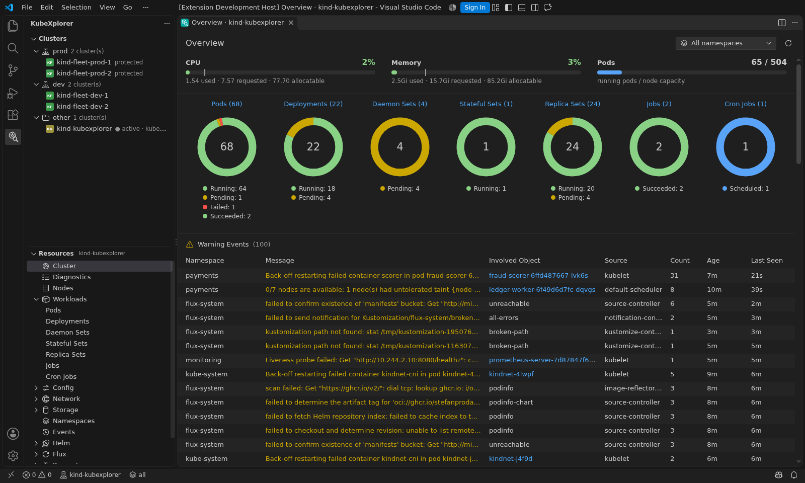

## Features

- **Clusters view**: every context of your kubeconfig, with a colored avatar like the Freelens hotbar, grouped by
  fleet group (`prod`, `dev`… from `kubexplorer.fleet.groups`), with the state of each cluster after a fleet scan.
- **Fleet**, for many clusters managed with Flux (**Open Fleet** in the Clusters view, or on a group):
  - **Clusters**: one row per cluster (reachable, Kubernetes and Flux versions, nodes, Kustomizations and Helm
    releases ready, revision of its sources, diagnostics), a card per group;
  - **Flux**: every Flux object across the clusters, with its drifts: not ready, suspended, behind its source,
    missing on clusters of its group (when at least half of the group has it: on fewer, it is specific to them), or
    running another revision or chart version than the rest of its group (the groups are compared separately: prod
    and dev may differ on purpose). A drift a rollout explains (after a push, the clusters take the new revision one
    after the other) shows as **Rolling out** until it lasts `kubexplorer.fleet.driftGrace` minutes. Its details list
    each cluster; **Reconcile**, **Suspend** and **Resume** run on every cluster, a group, the failing ones or the
    clusters you pick;
  - **Diagnostics**: the rules of the Diagnostics page on every cluster, the most errors first;
  - **Search**: workloads, images, pods, services, ingresses (name or host), Config Maps, namespaces or Flux
    objects across the clusters; a result opens in a tab of its cluster.

  A scan reads the nodes and the Flux objects of a cluster with a single `kubectl` request, a few clusters at a
  time, only while the Fleet tab is visible; diagnostics and searches run on demand. **Export** opens a Markdown
  report of the clusters shown (clusters, failing and drifting Flux objects, diagnostics, unreachable clusters), to
  paste into an issue or a wiki.

- **Resources view**: the Freelens side menu (Workloads, Config, Network, Storage, Namespaces, Events, Helm,
  Access Control) and your Custom Resources, discovered on the cluster. The Flux and Karpenter sections show up
  when their CRDs are installed.
- **Resource tabs**: sortable, searchable lists with live updates (watches), a resizable details drawer with
  links between objects and the events of the object, multi-namespace filtering, and bulk actions on the checked
  rows (restart, scale, reconcile, suspend, resume, cordon, uncordon, drain, delete). Opening another resource type reuses the current tab; **Open in New Tab**
  keeps one. Lists of thousands of objects stay fluid: only the rows in view are drawn, and only what changed is
  sent to them.
- **Diagnostics**, like Popeye: what is broken (crash loops, image pulls, rollouts stuck, services without ready
  pods, ingresses or pods referencing missing objects, nodes not ready…), what puts the applications at risk (no
  resource requests, floating image tags, OOM kills, autoscalers at their maximum, budgets blocking drains…) and what
  is worth a look (unused ConfigMaps, cordoned nodes…), with a health score per category. The problems also show up
  in the **Problems** view of VS Code: clicking one opens the YAML of its object.
- **Cluster overview**: CPU and memory usage against requests and allocatable capacity, workload status charts and
  the latest warning events.
- **Usage charts**: CPU, memory, network and filesystem over the last hour at the top of the details of pods,
  workloads and nodes, with requests, limits and allocatable capacity, like the Freelens metric tabs. KubeXplorer
  finds Prometheus on the cluster and queries it through the API server (no port forward); without Prometheus, the
  charts use metrics-server samples collected while VS Code runs. Lists show metrics-server CPU and memory columns
  and node gauges.
- **Flux**, following the [Freelens Flux extension](https://github.com/freelensapp/freelens-extension-fluxcd):
  Kustomizations, Helm releases, sources, image automation, notifications and Flux Operator objects, with their
  status, source links, inventory, release history, conditions and events; **Reconcile**, **Suspend** and
  **Resume** actions; an overview with a status chart per kind and the Flux events.
- **Karpenter**, following the [Freelens Karpenter extension](https://github.com/freelensapp/freelens-extension-karpenter):
  NodePools against their limits, NodeClaims, EC2, AKS and KWOK NodeClasses, a dashboard (NodePool cards, claims by
  status, nodes by capacity type, zone and instance type, scaling decisions) and a Karpenter section in the details
  of the nodes it manages.
- **Logs and shells** in the VS Code terminal: colored log levels, all containers or one, previous container,
  `kubectl exec` with bash or sh. The logs of a Deployment, StatefulSet, DaemonSet, ReplicaSet or Job follow all
  its pods at once, each pod in its own color, like `stern`.
- **Debug containers**: **Debug...** adds an ephemeral container (`kubectl debug`, busybox, netshoot or any image)
  sharing the processes of a container, and attaches it to a terminal: for distroless images without a shell.
- **Nodes**: **Cordon** and **Uncordon**, **Drain** (`kubectl drain --ignore-daemonsets --delete-emptydir-data`,
  followed in a terminal), and **Node Shell**: a root shell on the node, from a privileged pod of
  `kubexplorer.debug.image` in kube-system that enters its namespaces (`nsenter`), deleted when the shell exits.
- **CronJobs**: **Trigger Now**, **Suspend** and **Resume**.
- **Managed by Flux**: the drawer of an object applied by Flux links to its Kustomization or HelmRelease (from the
  labels Flux puts on what it applies). Scaling, deleting, applying YAML or editing a Secret value of such an object
  first warns that Flux will undo the change at its next reconciliation, and offers to suspend the Kustomization or
  HelmRelease first, like `flux suspend` before a hotfix.
- **YAML as a document**: edit any object in a real editor tab. **Ctrl+S** (or **Apply to Cluster** in the editor
  title) opens the diff against the object on the cluster, under a dialog to apply it (`kubectl replace`) or cancel.
  Conflicts surface as regular save errors. Auto save (`files.autoSave`) never applies anything to the cluster: only
  an explicit save does (set `files.autoSaveWorkspaceFilesOnly` to keep VS Code from trying).
- **Secrets**: values stay hidden; the eye button reveals one value at a time, on demand, and the pencil edits it in
  place (Ctrl+Enter saves). **Edit Decoded Values** opens the whole Secret with its values in clear, under
  `stringData`: no base64 to encode or decode.
- **Protected contexts**: the contexts matching `kubexplorer.protectedContexts` (`*prod*` by default) are framed in
  red, and every change asks you to type the name of its target; in `readOnly` mode, changes are refused.
- **Helm**: charts of your repositories (values, install) and releases (values, manifest, notes, history, rollback,
  uninstall).
- **Port forwarding** from pods and services, with a link to open the forwarded port in your browser, even in
  WSL or remote sessions.
- **Native VS Code UI**: context menus, quick picks, modal confirmations, status bar items, theme colors and
  keyboard navigation. The `freelens` appearance brings back the original Freelens palette.

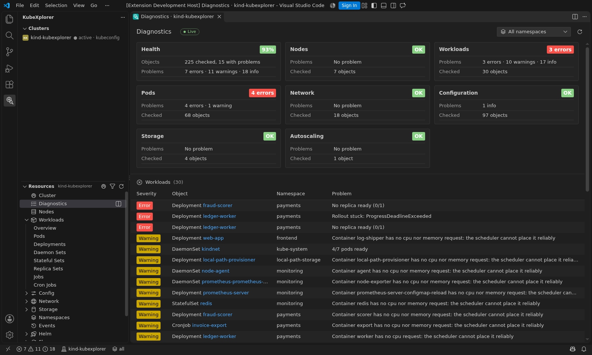

| Workloads and details                     | Logs in the terminal, native context menu                       |
| ----------------------------------------- | --------------------------------------------------------------- |
| 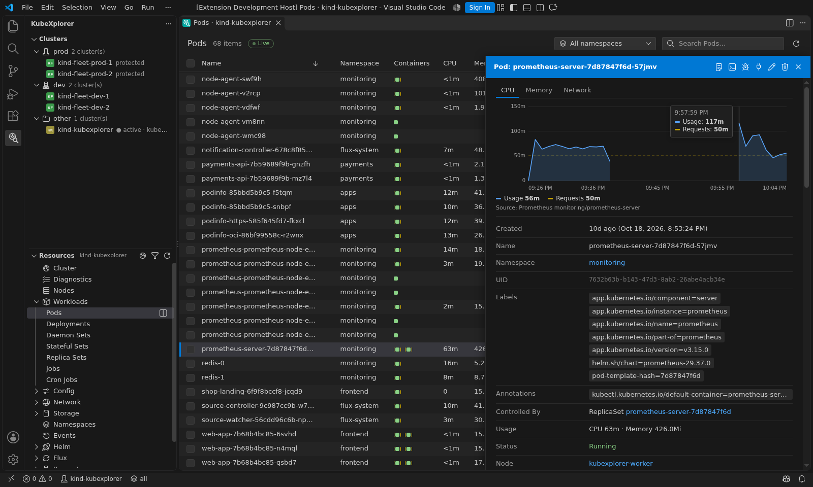 | 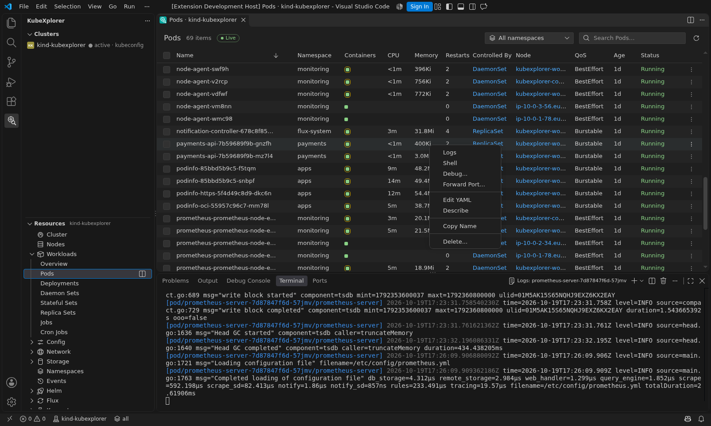 |
| **Secrets, revealed on demand**           | **Helm releases**                                               |
| 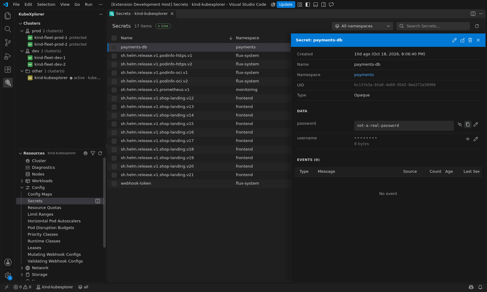       | 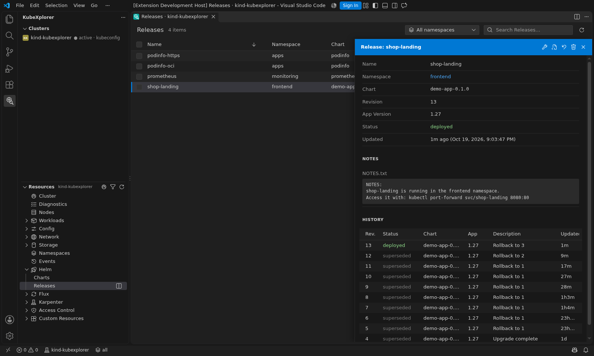                          |
| **Flux overview**                         | **Flux Kustomization, with its inventory**                      |
| 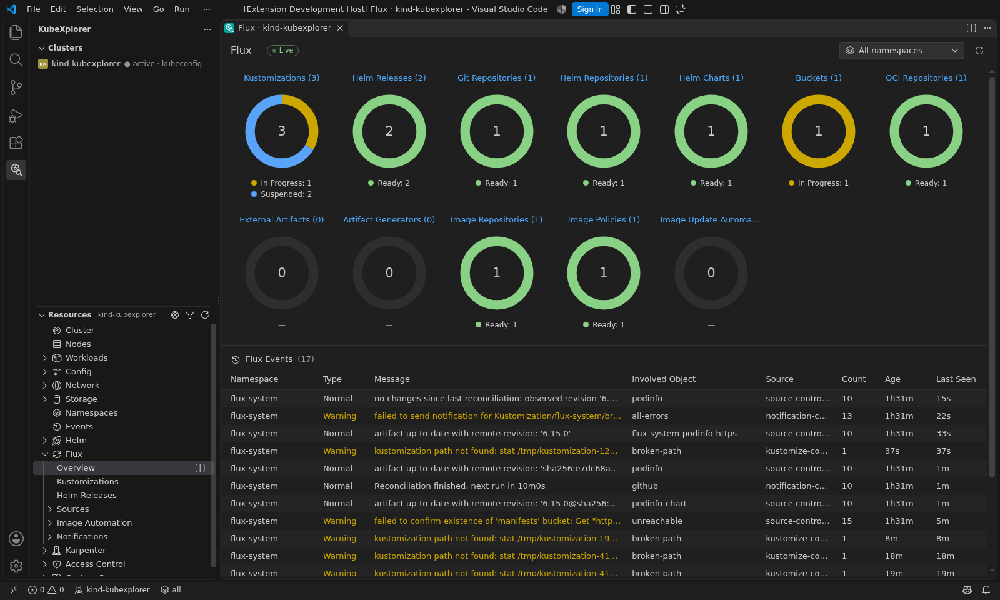    | 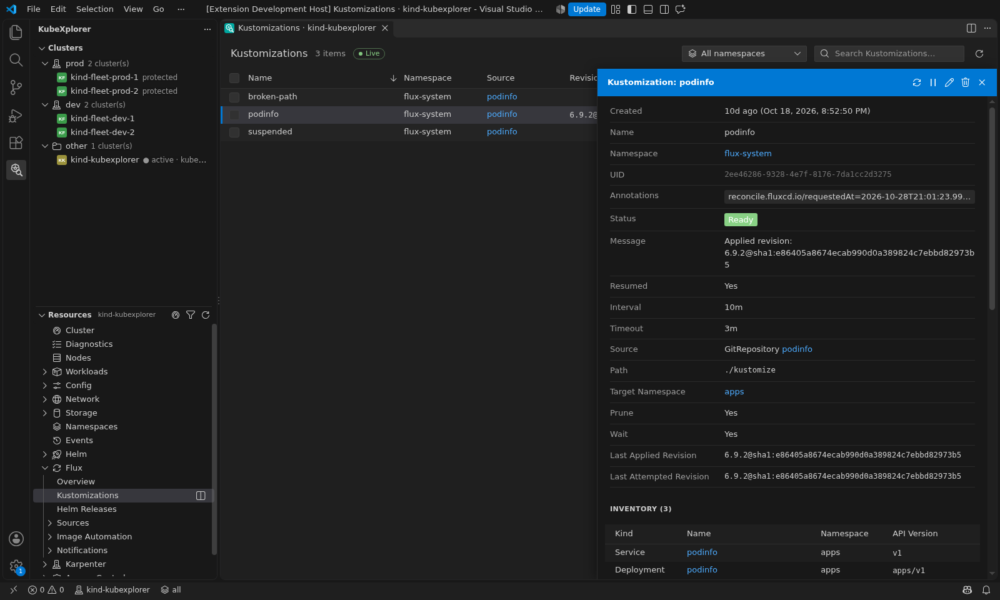      |
| **Fleet: every cluster**                  | **Fleet: a Flux object across the clusters, with its drift**    |
| 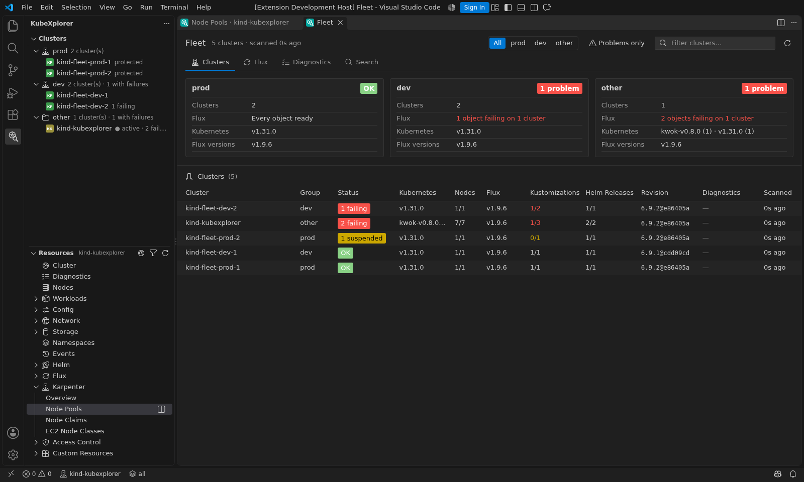           | 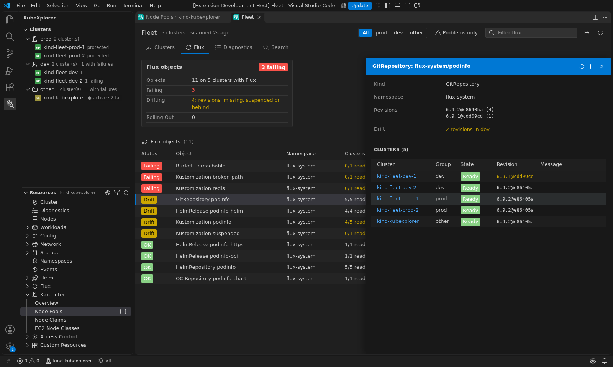                       |
| **Karpenter dashboard**                   | **Karpenter NodePool**                                          |
| 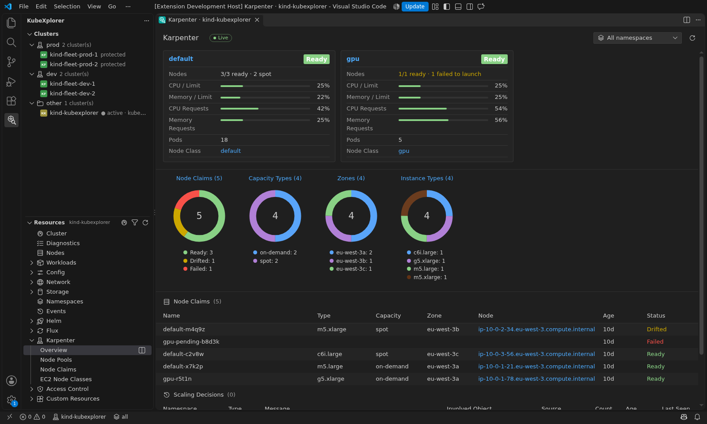   | 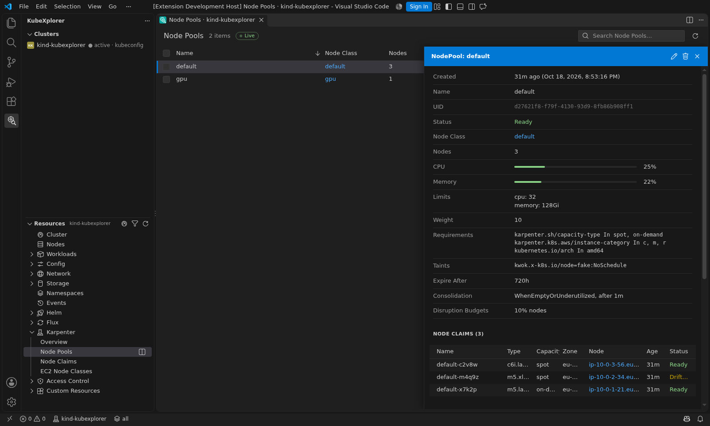       |

## Requirements

- VS Code 1.90 or later.
- [`kubectl`](https://kubernetes.io/docs/tasks/tools/) on your `PATH` (or set `kubexplorer.kubectlPath`), and a
  kubeconfig. KubeXplorer uses kubectl for everything, so every authentication plugin kubectl supports works.
  The lists and watches of a cluster go through a single `kubectl proxy`, started on first use and stopped after a
  few idle minutes (a cluster whose proxy cannot start falls back to a kubectl process per request).
- Optional: [`helm`](https://helm.sh/docs/intro/install/) for the Helm views,
  [metrics-server](https://github.com/kubernetes-sigs/metrics-server) on the cluster for CPU and memory figures,
  and Prometheus (kube-prometheus-stack, the prometheus chart or any Prometheus scraping cAdvisor) for an hour of
  usage history and the network and filesystem charts.

## Getting started

1. Open the **KubeXplorer** view in the activity bar.
2. Pick a cluster in **Clusters** (the current context of your kubeconfig is selected by default).
3. Open a resource type in **Resources**. Click a row for its details; right-click it, or use `⋮`, for actions.

In a resource tab: `Ctrl+F` or `/` searches, `↑`/`↓` move the selection while the drawer is open, `Escape`
closes the drawer.

Without a cluster at hand, run **KubeXplorer: Show/Hide Demo Cluster** to explore a fictitious, offline cluster.

## Settings

| Setting                             | Default                                  | Description                                                                                                    |
| ----------------------------------- | ---------------------------------------- | -------------------------------------------------------------------------------------------------------------- |
| `kubexplorer.kubectlPath`           | `kubectl`                                | Path to kubectl.                                                                                               |
| `kubexplorer.helmPath`              | `helm`                                   | Path to helm.                                                                                                  |
| `kubexplorer.watch`                 | `true`                                   | Follow lists in real time. When disabled, lists are polled.                                                    |
| `kubexplorer.pollInterval`          | `5`                                      | Polling interval (seconds) for lists that cannot be watched; metrics at most every 15 s, Helm every minute.    |
| `kubexplorer.reuseTab`              | `true`                                   | Reuse the current tab when opening another resource type.                                                      |
| `kubexplorer.appearance`            | `vscode`                                 | `vscode` follows your color theme; `freelens` uses the Freelens dark palette.                                  |
| `kubexplorer.confirmApply`          | `true`                                   | Ask before applying a saved YAML document.                                                                     |
| `kubexplorer.protectedContexts`     | `["*prod*"]`                             | Contexts to protect (patterns, `*` matches any text): framed in red, changes confirmed by typing a name.       |
| `kubexplorer.protectedContextsMode` | `confirm`                                | `confirm`: type the name of the target of each change; `readOnly`: no change at all, no shell.                 |
| `kubexplorer.logs.tailLines`        | `500`                                    | Past log lines shown when opening logs.                                                                        |
| `kubexplorer.debug.image`           | `busybox:1.37`                           | Image of the ephemeral containers of **Debug...** and of **Node Shell** (it needs `nsenter`).                  |
| `kubexplorer.prometheus`            | (empty)                                  | Prometheus of the usage charts, as `namespace/service:port`; empty detects it; `off` uses metrics-server only. |
| `kubexplorer.fleet.groups`          | `{"prod": ["*prod*"], "dev": ["*dev*"]}` | Fleet groups: name → context patterns; the others are in `other`.                                              |
| `kubexplorer.fleet.contexts`        | `["*"]`                                  | Contexts the Fleet tab scans (patterns).                                                                       |
| `kubexplorer.fleet.concurrency`     | `8`                                      | Clusters read at the same time (one `kubectl` process each).                                                   |
| `kubexplorer.fleet.refreshInterval` | `120`                                    | Seconds between two scans while the Fleet tab is visible.                                                      |
| `kubexplorer.fleet.driftGrace`      | `10`                                     | Minutes before a revision drift, a missing object or one behind its source counts (rolling out until then).    |
| `kubexplorer.demoCluster`           | `false`                                  | Add an offline demo cluster to the Clusters view.                                                              |

The **Output › KubeXplorer** channel logs every kubectl and helm command (set its level with **Developer: Set Log
Level...**).

## Security and privacy

- KubeXplorer never changes the current context of your kubeconfig: every command passes `--context` explicitly.
- Destructive actions (delete, scale to zero, restart, rollback, uninstall, apply) ask for confirmation and name
  the target context. On protected contexts (`kubexplorer.protectedContexts`), every change asks you to type the
  name of its target, or is refused in `readOnly` mode. Fleet actions leave the read-only clusters out, and ask to
  type the name of the object when one of the clusters is protected.
- The Fleet tab reads the clusters of `kubexplorer.fleet.contexts` (nodes and Flux objects) only while it is
  visible, and never changes them unless you run an action.
- Secret values are never sent to the UI, except the one you reveal, and are never stored. The Diagnostics page
  reads the metadata of Secrets only.
- The `kubectl proxy` of a cluster listens on a Unix socket in a directory only you can open (on Windows: on
  127.0.0.1, a random port, behind a random secret path), and refuses anything but reading (GET; kubectl also
  refuses exec and attach through it). Changes always go through kubectl commands.
- In untrusted workspaces, `kubexplorer.kubectlPath` and `kubexplorer.helmPath` are ignored if set by the
  workspace, so opening a repository cannot make KubeXplorer run an arbitrary binary.
- `kubexplorer.protectedContexts`, `kubexplorer.protectedContextsMode` and `kubexplorer.confirmApply` are user (or
  remote) settings: the `.vscode/settings.json` of a repository cannot turn off the protection of your production
  contexts or the review of the changes.
- Auto save never applies a YAML document to the cluster.
- No telemetry.

To report a vulnerability, see [SECURITY.md](SECURITY.md).

## Contributing

Contributions are welcome: see [CONTRIBUTING.md](CONTRIBUTING.md) for the development setup (including a local
kind cluster), and [docs/architecture.md](docs/architecture.md) for how the code is organized.

## Acknowledgements

The layout, colors and status rules of the resource tabs come from [Freelens](https://github.com/freelensapp/freelens),
the open source Kubernetes IDE (MIT), and the Flux and Karpenter views from its Flux and Karpenter extensions.
KubeXplorer is an independent project.

## License

[MIT](LICENSE)
